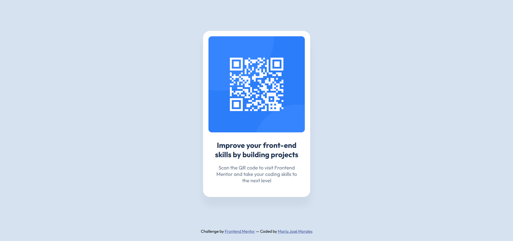

# Frontend Mentor - QR code component solution

This is a solution to the [QR code component challenge on Frontend Mentor](https://www.frontendmentor.io/challenges/qr-code-component-iux_sIO_H). Frontend Mentor challenges help you improve your coding skills by building realistic projects. 

## Table of contents

- [Overview](#overview)
  - [Screenshots](#screenshots)
  - [Links](#links)
- [My process](#my-process)
  - [Built with](#built-with)
  - [What I learned](#what-i-learned)

## Overview

### Screenshots

- Desktop

- Mobile

### Links

- Solution URL: [https://github.com/moralesmj/qr-code-component](https://github.com/moralesmj/qr-code-component)
- Live Site URL: [https://qr-code-component-rho-jet.vercel.app/](https://qr-code-component-rho-jet.vercel.app/)

## My process

### Built with

- HTML and CSS
- Flexbox
- Google Fonts (Outfit)
- `rem` units for font sizes and spacing
- Responsive sizing with `width` + `max-width`

### What I learned

**1. Inline images leave a phantom gap:**
Images are inline by default so they sit on a text baseline that reserves space for letter descenders (like the tails on "g", "y", "p"). `display: block` removes the gap.

**2. `margin: auto` on a flex child can center it and push siblings to the edge:**
In my case, `body` is a flex column containing the card and the footer. Giving `main` the `margin: auto` lets its auto margins absorb the free vertical space equally (centering the card) while pushing the footer to the bottom.

**3. `box-sizing: border-box` prevents unwanted scrollbar.**

**4. `rem` is more accessible than `px` for font sizes.**

**5. `max-width` beats `width` for responsive images.**